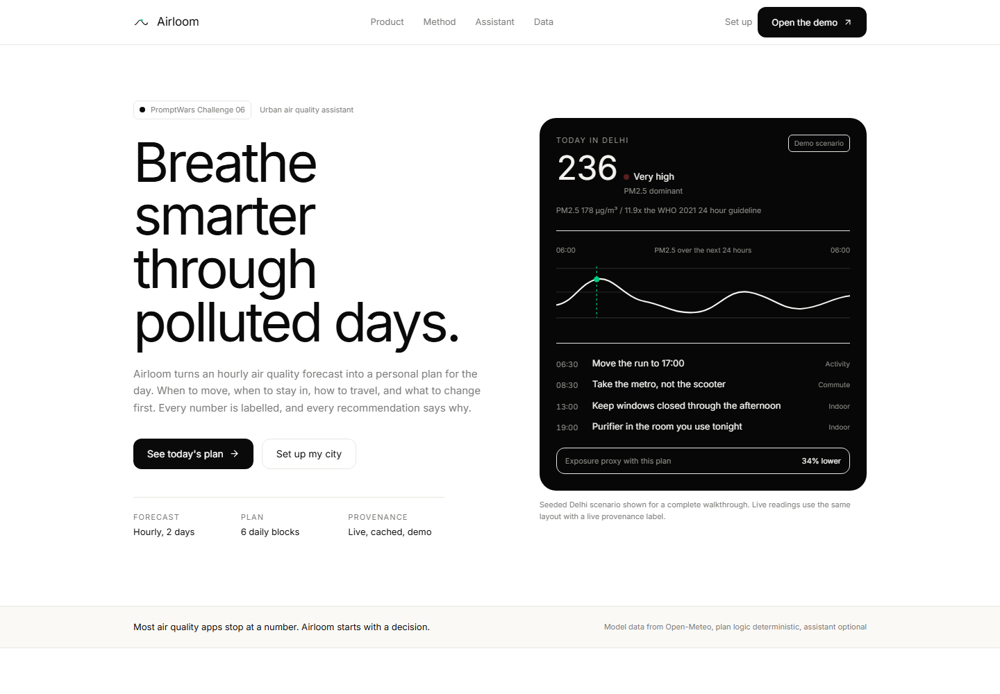

# Airloom

**Breathe smarter through polluted days.**

Airloom turns an hourly air-quality forecast into a personal decision plan: when to move, when to stay in, how to commute, when to ventilate, and what to change first. Every recommendation states its reason and its data source.

[Live app](https://airloom-brown.vercel.app) · [Method](https://airloom-brown.vercel.app/#method) · [Technical write-up](docs/TECHNICAL_WRITEUP.md)



## Problem

Most air-quality products stop at a number. A single AQI value does not answer the decisions a household actually makes on a polluted day:

- Should the run happen now or later?
- Which commute option has lower exposure?
- When is it safe to open the windows?
- Is the purifier worth running tonight?
- Which changes matter next month?

Airloom starts from those decisions, not from the dashboard.

## Solution

Airloom reads hourly pollution and weather data, computes exposure planning values, and turns them into six daily action blocks: morning, commute, midday, afternoon, evening and night. Each block has an action, time window, reason, confidence and stated basis.

Core surfaces:

- Location onboarding with city search and browser geolocation
- Seeded demo cities: Delhi, Mumbai, Bengaluru, Kolkata and Lucknow
- AQI and PM2.5 views with hand-rolled SVG charts
- Six-block daily plan
- Commute comparison by time, exposure proxy and estimated CO2
- Indoor infiltration estimate and ventilation windows
- Lower-exposure swaps with stated impact
- Grounded AI assistant with a deterministic rule-based fallback
- Provenance labels on every reading: live, cached or demo

Demo data is never presented as live data.

## Proof

- **82/82 tests pass** (`npm test`): AQI breakpoints, category boundaries, exposure math, deterministic plans, sensitive-household thresholds, commute ordering, indoor estimates, swap output, copilot schema rejection, grounding validation, contradiction detection, AI provider pipeline, safety gate, profile management, and demo provenance.
- **Deterministic core.** Identical inputs produce identical plans and recommendations.
- **Production is live.** The deployed app returns HTTP 200.
- **Fail-safe assistant.** If Nemotron and Gemini are unavailable, return invalid output, time out or are not configured, the deterministic rule engine answers instead.
- **Safety boundary.** The assistant does not diagnose medical conditions, and symptomatic questions do not receive outdoor exposure recommendations.

## How it works

```text
Open-Meteo hourly data
  → AQI + exposure calculations
  → six-block plan
  → optional model explanation (Nemotron → Gemini)
  → provenance-labelled UI
```

Airloom computes US EPA AQI values for PM2.5 and PM10, lower- and higher-pollution windows, an exposure proxy (`PM2.5 × duration × transport factor`), commute comparisons, indoor infiltration estimates and sustainable-transport comparisons.

The AI copilot receives the same context shown in the product, is validated with Zod, and falls back to deterministic rules. It does not invent measurements.

## Technology

- Next.js 16, React 19, TypeScript
- Tailwind CSS 4
- Zod
- Open-Meteo air quality, weather and geocoding APIs
- Nemotron and Gemini 2.5 Flash, server-side only (optional keys)
- Hand-rolled SVG charts (no charting library)
- Vercel

## Demo

Live: **https://airloom-brown.vercel.app**

The seeded Delhi scenario is the fastest walkthrough. The **Method** section on the landing page explains the calculations and their limits.

## Run locally

```bash
npm install
npm run dev
```

Open http://localhost:3000.

```bash
npm run build
npm run start
npm run lint
npm run typecheck
npm test
```

`NVIDIA_API_KEY` and `GEMINI_API_KEY` are optional. Without them, the product runs on deterministic rules.

## Limitations

- Air quality is modelled data, not a doorstep sensor.
- AQI is a planning estimate based on US EPA breakpoints, not an official CPCB measurement.
- Exposure is a planning proxy, not inhaled dose or medical risk.
- Indoor values come from an infiltration model, not a sensor reading.
- Forecast uncertainty increases further into the forecast period.
- Airloom is decision support, not a medical service.

## Data and security

User profile settings stay in browser local storage. Provider keys remain server-side. Production responses include `X-Content-Type-Options: nosniff`, `Referrer-Policy: strict-origin-when-cross-origin`, `X-Frame-Options: DENY` and a scoped `Permissions-Policy`. See [`docs/DATA_METHODOLOGY.md`](docs/DATA_METHODOLOGY.md) and [`docs/TESTING.md`](docs/TESTING.md).

## Context

Built for PromptWars Virtual Main Challenge 06, theme **Urban Air Quality Assistant**.

## Author

Swapneel Sethi · [GitHub](https://github.com/Swapneel-Sethi)
